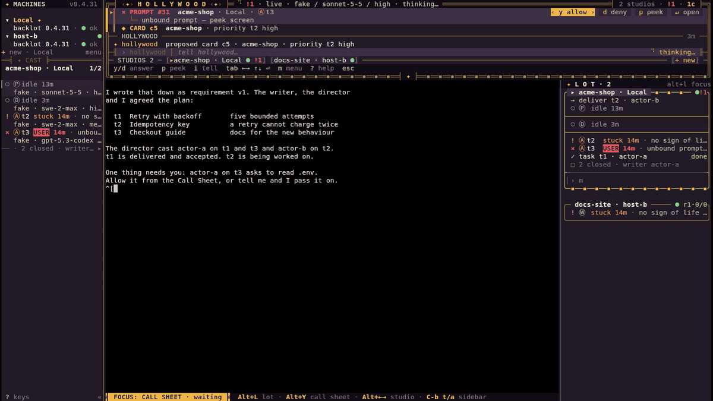
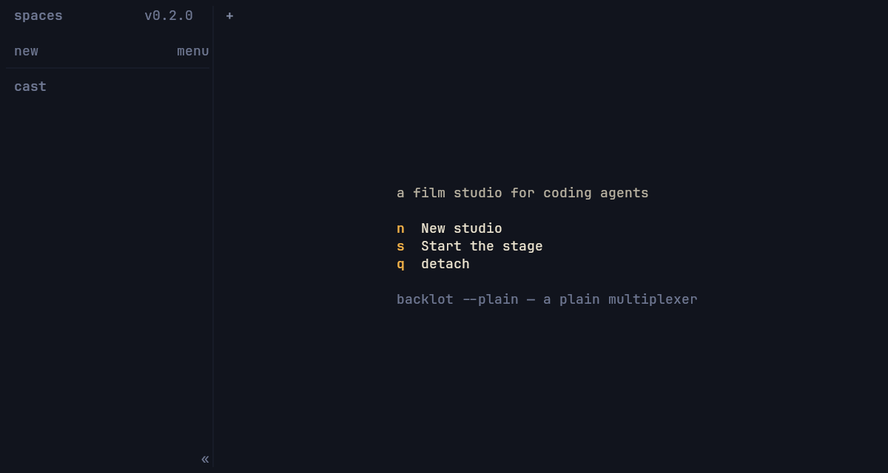
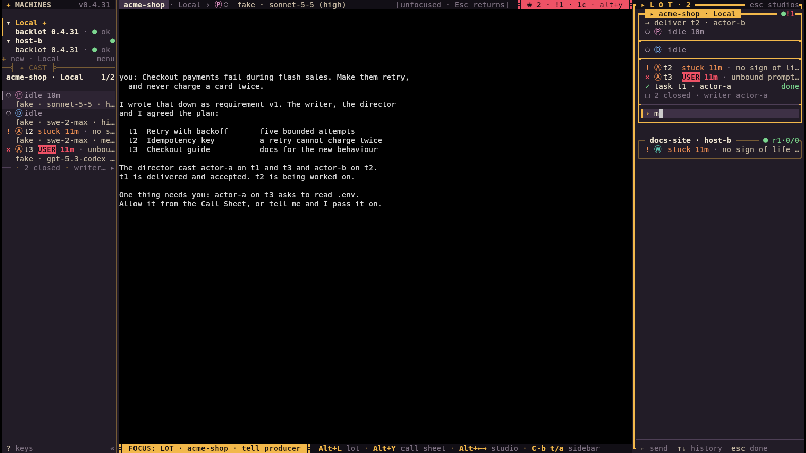
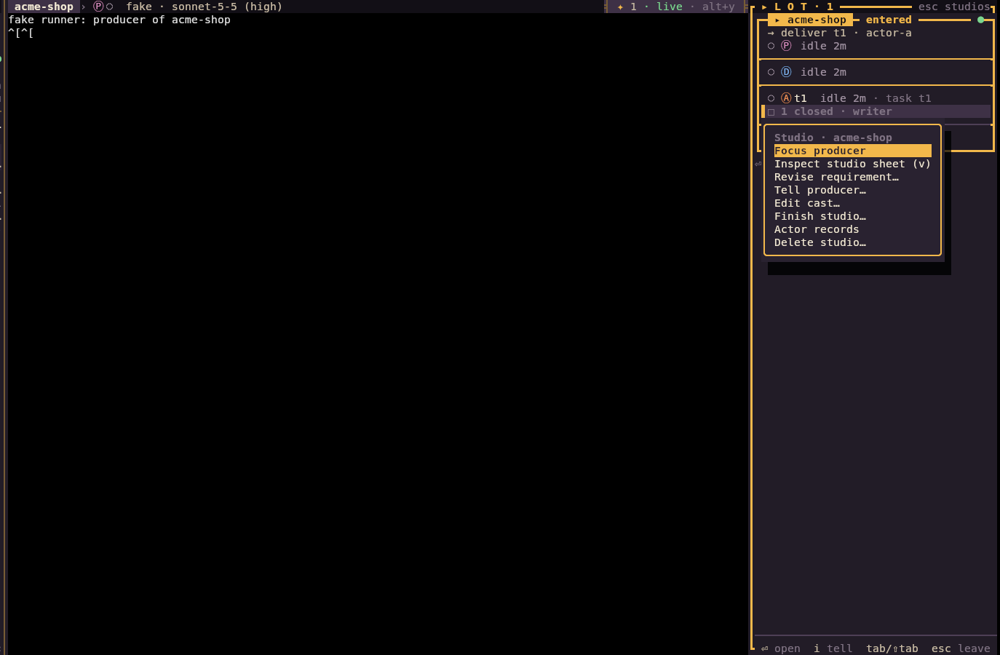
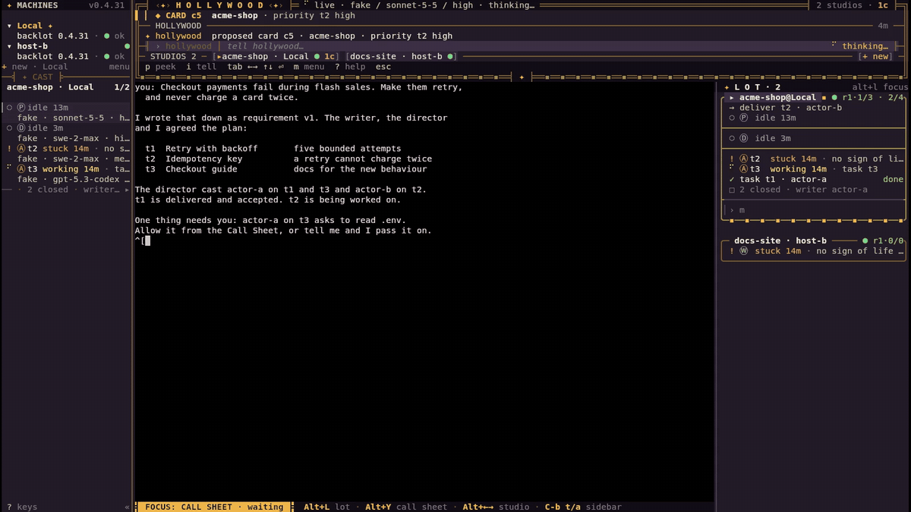
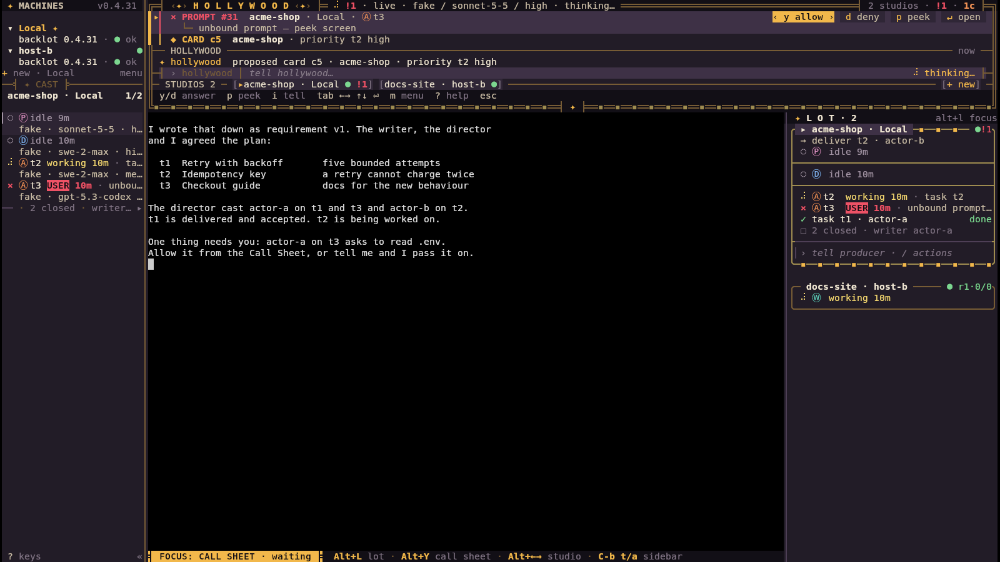
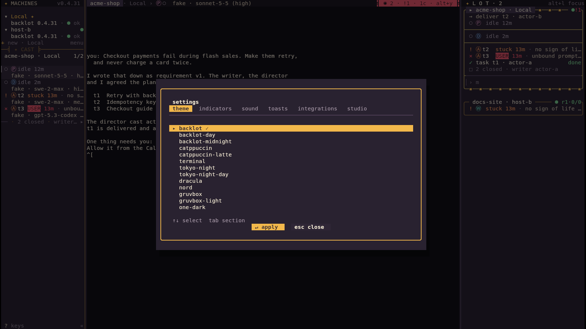

# backlot

A film studio for coding agents, in your terminal. You give one requirement to a producer; the opening discussion
settles the design; a director splits the plan into tasks and casts agents onto them, each in its own git worktree;
deliveries, checks, reviews and rework go on a record; and the Lot shows who is doing what. Every role is an
ordinary terminal you can open and type into.


*A demo studio on the test runner, with invented projects and agent output.*

backlot runs on [herdr-core](https://github.com/herdrdev/herdr-core) (`hc`), which keeps the terminals alive
on your machine or a server. The client is a studio tool, a fork of
[hc-tui](https://github.com/followcat/hc-tui): it opens on your studios, every terminal it creates belongs
to one, and the plain multiplexer lives on behind `backlot --plain` (for a general-purpose client, use
hc-tui). Unofficial project, not affiliated with or endorsed by the Herdr project.

## What it is for

Running several coding agents by hand makes you the scheduler: you copy the plan between windows, remember who
is waiting for what, notice late that one of them stopped on a prompt, and lose track of which branch holds
what. backlot takes that job:

- **One requirement, a small cast.** You talk to the producer. The producer, writer, director and you continue
  the opening discussion until the design is final. Then the writer derives the plan and acceptance list, the
  director turns the plan into tasks and reviews the work, and actors do the tasks.
- **Mixed casts.** Each role names its own agent CLI and model: Claude Code, Codex, Devin, OpenCode,
  cursor-agent or Command Code. A cheap model can do the typing while a stronger one reviews. The cast file only
  initializes the studio; you can revise the cast while keeping the studio's binding and push remotes.
- **Nothing hidden.** Roles are plain `hc` terminals. Open one, read it, type into it. Stop backlot and they
  are still there.
- **A record, not a chat log.** Talking never moves a task; a `backlot` command does. The ledger says what was
  delivered, which checks ran, what the review said and who did it. Only you finish a studio.
- **Your prompts stay yours.** The stage never answers a permission prompt that belongs to you. The Call Sheet
  lifts it to the top, and you decide.


## What works today

- **The whole studio loop**: opening design, plan and acceptance list, dispatch, tasks with dependencies, casting,
  delivery, checks, review, rework up to a cap, merge into an integration branch, finish.
- **The stage**, one scheduler per core. It starts each role in its place (actors in their own worktree and
  branch), delivers messages only when a role is idle and never into a dialog, nudges a step that is owed,
  runs your declared checks on every delivery in a clean worktree, and brings the roles back after `hc`
  restarts.
- **The Call Sheet.** Waiting questions, cards, prompts and stopped stages go on top. `Tab` moves through its
  zones and only the focused zone expands; `Alt+Y` opens or folds it. Desktop notifications tell you once when
  a new question or card needs you.
- **The Lot and cast.** The sidebar lists the current studio's people with role badges `Ⓟ Ⓓ Ⓦ Ⓐ`. The Lot
  docks one bordered block per studio: people, state, what is owed, and what needs you. `Alt+L` enters it;
  row menus (`m`) carry the actions that row can take; compose always names its target in a chip.
- **Several studios on one or more cores**, each with its own repository, cast, ledger and limits.
- **Limits and budgets**: a cap of live roles per agent CLI, a running-time budget per task.
- **Hollywood, the overseer**: one agent above all studios. The stage tells it what happens in each studio; it
  reports, and it proposes *cards* (pause, resume, abandon, priority, close, reopen, new studio). A card does
  nothing until you apply it, and the stage checks again that nothing moved before it carries one out.
- **The terminal client**: sidebar of machines and agents with live status, tabs, split panes, zoom, keyboard
  copy mode, mouse selection that copies on release, remote use over SSH with image paste, and the Babylon theme.



What has been tried on real agents and what has only run on the test runner is written down, per agent CLI,
in [docs/studio/limits.md](docs/studio/limits.md). Read it before you trust a studio with real work.

## Install

backlot is one static binary. The script installs it and, when it's missing, the `hc` core it talks to.
Prebuilt archives cover Linux (x86_64 and aarch64, static musl) and macOS (arm64 and Intel).

```sh
curl -fsSL https://github.com/followcat/backlot/releases/latest/download/install.sh | sh
```

The script verifies the archive against the release's `sha256sums.txt` and installs to `~/.local/bin` without
sudo. Pin a release with `BACKLOT_VERSION=v…`, skip the core install with `BACKLOT_SKIP_CORE=1`, or fetch an
archive from the [Releases page](https://github.com/followcat/backlot/releases) and check it yourself. The client
shows its version in the top-left corner and, once a newer release is out, an arrow with that version; upgrade
with `backlot --upgrade`, which runs the script again. Uninstall by deleting the binary. Details:
[docs/install.md](docs/install.md).

**v0.4.31 is the current release.** Its interface is the Babylon look: the gilded Lot and Call Sheet, role
badges and dividers, a compose target chip, row menus, opening-design reading and sign-off, desktop notifications
for questions and cards, and person-only actions made explicit to every role. `main` can be ahead of the latest
release: [build from source](#build-from-source) for the newest.

## Run a studio

You need `hc`, a git repository with at least one commit, and at least one agent CLI installed and logged in.

**1. Say who plays each role**, in a cast file:

```toml
# /home/user/cast.toml
design_gate = "required"   # the default: agree the opening design first

[producer]
runner = "claude"
model = "sonnet-5-5"
effort = "high"
permission_profile = "standard"

[director]
runner = "claude"
model = "sonnet-5-5"
effort = "high"
permission_profile = "standard"

[writer]
runner = "claude"
model = "haiku-5-5"
effort = "medium"
permission_profile = "standard"

[[candidates]]            # the actors the director may cast
name = "actor-a"
runner = "codex"
model = "gpt-5.3-codex"
effort = "medium"
permission_profile = "worktree"

[[checks]]                # the stage runs these on every delivery
name = "units"
run = "cargo test --lib"
timeout_s = 120
```

**2. Create the studio and start the stage:**

```sh
hc server start
backlot studio new --studio acme-shop --title "Shop" --repo /home/user/acme-shop --cast /home/user/cast.toml
backlot stage start
```

Or let the client do it: open `backlot` with no studio and you land on the opening page — a film-strip
title card with `n` for a new studio, `s` to start the stage and `q` to detach. Press `n` and a wizard opens a
repository picker, asks for the studio name and the cast — drafted from the agent CLIs it finds on the machine;
`backlot runners` prints the same table — then offers to start the stage.



**3. Open the client and talk to the producer:**

```sh
backlot
```

The sidebar shows the current studio's cast. `Alt+L` enters the Lot and `Alt+Y` the Call Sheet. Enter on a
person focuses its terminal: type what you want built, as you would tell a person. Targeted compose shows the
recipient before you send:



Every studio is its own space in the client, its roles are the tabs. A new tab or split opens a *studio
shell* — your own terminal in the focused person's worktree — listed under `shells` in the cast. The
stage never touches it, and closing it is your call alone.

Rows have menus. On a task the menu carries the task's own actions — inspect its deliveries and reviews,
change priority, pause it, take it over or abandon it — rather than making you remember a command:



The commands you will use most:

| Command | What it does |
|---|---|
| `backlot status --studio acme-shop` | The studio's recorded state and the steps still owed, with their owners. |
| `backlot studio list` | Every studio on every core, with its state, title and path — `--json` for the same rows. |
| `backlot tell director --file note.md --studio acme-shop --as user` | A recorded message to a role. |
| `backlot approve --person actor-t1-c1 --decision allow --studio acme-shop --as user` | Answer a permission prompt that is yours. |
| `backlot records --studio acme-shop` | What each actor delivered and how the reviews went. |
| `backlot metrics --all --since 7d` | Read-only quality, attention, guard, Hollywood, and timing metrics across studios. |
| `backlot digest --studio acme-shop --since 24h` | Daily summary and `design v<N> §<id>` coverage matrix for a studio. |
| `backlot tell hollywood "what is waiting on me?"` | Ask the overseer. It answers with a report. |
| `backlot card list`, `backlot card apply c1`, `backlot card cancel c1` | Hollywood's proposals: look, then apply or cancel. |
| `backlot studio finish --reason "all tasks accepted" --studio acme-shop --as user` | Close the studio. |

The full walkthrough, with the cast file's every key, permission prompts, recovery after a restart and where
the files live, is [docs/studio/guide.md](docs/studio/guide.md). Hollywood is set up in
[docs/studio/hollywood.md](docs/studio/hollywood.md).

## The client

backlot is also the terminal you work in. The default prefix is `Ctrl+B`:

| Keys | |
|---|---|
| `Alt+L` | Enter the Lot |
| `Alt+Y` | Open or fold the Call Sheet |
| `Ctrl+B a` | Focus the cast; `Ctrl+B t` focuses the machines tree |
| `Ctrl+B w` | Move between spaces, tabs and agents |
| `Ctrl+B v`, `Ctrl+B -` | Split the pane to the right, or downwards |
| `Ctrl+B b` | Show or hide the sidebar |
| `Ctrl+B s` | Settings: theme, status indicators, sound, notifications |
| `Ctrl+B ?` | Every key, searchable |
| `Ctrl+B u` | Check for a newer release: notes, one-key upgrade and restart |
| `Ctrl+B q` | Detach. Everything keeps running |
| `Ctrl+G` | Lock the keyboard, so every key goes to the program |

Agents can also show `◌ waiting`: their own turn is quiet, but work they started is still running — a background
shell under the agent's process tree, or, for Claude Code, a `shell` status in its own session file. The check
runs every few seconds through the core and never changes the agent's reported status, marks anything seen, or
raises a notification.

The Call Sheet is the top layer in studio mode. Waiting items stay in their zones — prompts, Hollywood, studios —
`Tab` moves between zones, and only the focused zone expands so the sheet stays small:



Hollywood sits in the same sheet when configured. Its conversation and cards are visible there, and a waiting
card carries the keys to inspect, apply or cancel it:



Key bindings, the sidebar and the other settings are read from your Herdr config when you have one. Run it
against a local core or a remote one over plain SSH:

```sh
backlot --session <name>
backlot --remote <ssh-target> --session <name>
backlot --plain                    # the plain multiplexer — no studio mode
```

More in [docs/keys.md](docs/keys.md) and [docs/remote.md](docs/remote.md).

### Theme

backlot has a look of its own, so you can tell it from hc-tui and Herdr at a glance: the default `backlot` theme
is Babylon Night — black lacquer, rose velvet and brass — with `backlot-day` as its light sibling and
`backlot-midnight` as the older selectable look. Pick another theme with `Ctrl+B s`, or set `source = "herdr"`
to follow your Herdr theme. [docs/theme.md](docs/theme.md) has the details.



## Status

Early, and honest about it:

- **Two casts have run the whole loop on real agents.** Claude Code in every role, four times on a sample
  repository; the fourth run stopped the `hc` core twice and every live role resumed its own session. And a
  mixed cast, twice: Devin as director, cursor-agent as writer and Command Code as the actors, with the
  producer on the test runner; the second run had two actors at once and ended with the studio finished.
  Codex and OpenCode were launched and measured, not run through a whole studio.
  [docs/studio/limits.md](docs/studio/limits.md) has the details.
- **Hollywood has only run on the test runner.** Its first run on a real agent is the next step.
- **It runs on official `hc`.** Official `hc` 0.1.22 is the tested build; older 0.1.x cores keep working, with
  each missing capability switched off. Day-to-day use is still mostly on
  [followcat/herdr-core](https://github.com/followcat/herdr-core), a fork of `hc`. On official `hc` an agent
  shows a status only if it reports one itself, and the sidebar's Git and hostname details are unavailable.
  The fork publishes its own facts; its client contract is documented in
  [docs/fork-features.md](https://github.com/followcat/herdr-core/blob/v0.1.21-followcat.1/docs/fork-features.md).
  See [Core compatibility](docs/compatibility.md).
- **The macOS builds** pass CI but haven't been tried on a real Mac yet.

## Build from source

You need a recent stable Rust toolchain. The client binary is `backlot`; the same crate can also build the
general-purpose `hc-tui` binary when needed.

```sh
git clone https://github.com/followcat/backlot.git
cd backlot
cargo build --release
./target/release/backlot
```

The test suite uses scratch sessions and temporary config directories; it never touches your live `hc` session.
See [docs/studio/testing.md](docs/studio/testing.md).

## Documentation

- [Studio guide](docs/studio/guide.md) — an end-to-end studio, the cast file, prompts, recovery and files
- [The Lot and Call Sheet](docs/studio/panel.md) — what the client shows and what each key does
- [Hollywood](docs/studio/hollywood.md) — setup, reports and cards
- [Keys](docs/keys.md) — every default binding
- [Install](docs/install.md) — installer details and verification
- [Core compatibility](docs/compatibility.md) — official and forked `hc` capabilities
- [Theme](docs/theme.md) — Babylon Night/Day, midnight and Herdr themes

## License

Apache-2.0. See [LICENSE](LICENSE) and [NOTICE](NOTICE).
