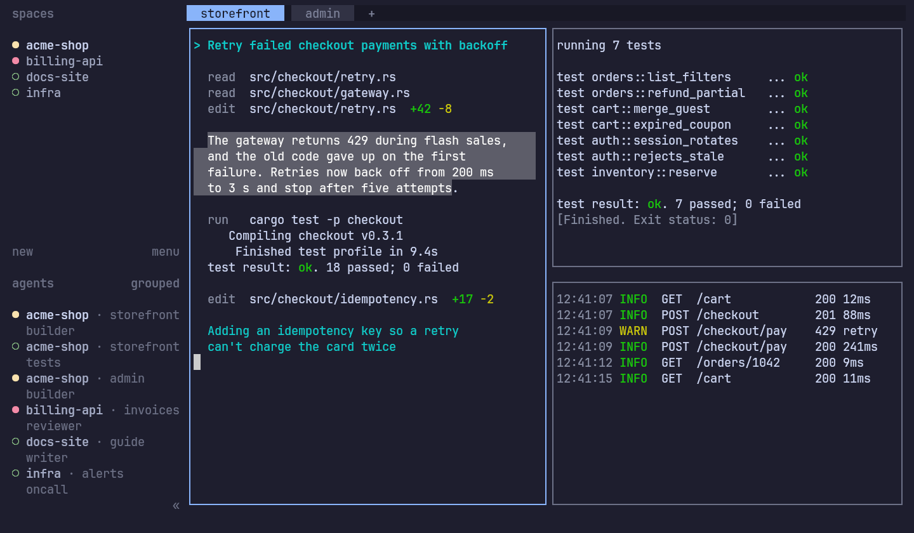
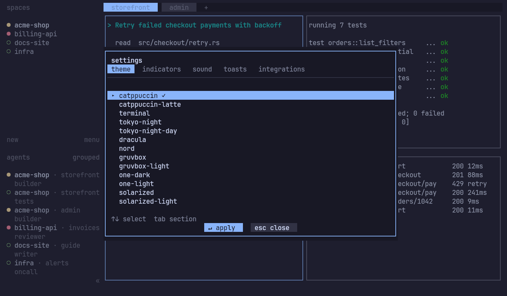

# hc-tui

An unofficial terminal UI for [herdr-core](https://github.com/herdrdev/herdr-core) (`hc`). Use it if you work in a
terminal or on a machine with no desktop, and want the Herdr TUI on top of `hc`.


## Features

- A sidebar of spaces and agents. Each agent shows whether it's working, blocked, done or idle. Machines added with
  `hc machine add` appear there too.
- Tabs, split panes and zoom. `Ctrl+G` locks the keyboard, so every key goes to the program.
- Select text with the mouse and it's copied when you let go. This uses OSC 52, so your terminal has to allow it.
- Your Herdr key bindings, theme and other settings carry over from your existing Herdr config.
- Spaces and tabs come from the same `herdr-app` document the desktop app uses.
- Works locally or over plain SSH. Your terminals stay on the server when you detach.

| Mouse selection | Settings |
|---|---|
|  |  |

## Install

You need `hc` first: see [herdr-core](https://github.com/herdrdev/herdr-core). Then:

```sh
curl -fsSL https://github.com/followcat/hc-tui/releases/latest/download/install.sh | sh
```

This puts a single binary in `~/.local/bin`, without sudo, after checking it against the release's `sha256sums.txt`.
There are builds for Linux (x86_64 and aarch64) and macOS (arm64 and Intel). To pin a version, upgrade or uninstall,
see [docs/install.md](docs/install.md).

If the [Releases page](https://github.com/followcat/hc-tui/releases) is still empty, the first release isn't out yet,
so [build from source](#build-from-source).

## Usage

```sh
hc-tui                                  # the default session
hc-tui --session work
hc-tui --remote host-a --session work   # over SSH
```

The prefix is `Ctrl+B`, as in Herdr:

| Keys | Action |
|---|---|
| `Ctrl+B w` | Navigate workspaces |
| `Ctrl+B c` | New tab |
| `Ctrl+B v`, `Ctrl+B -` | Split right, split down |
| `Ctrl+B h/j/k/l` | Move focus |
| `Ctrl+B z` | Zoom the pane |
| `Ctrl+B b` | Show or hide the sidebar |
| `Ctrl+B ?` | Search the key bindings |
| `Ctrl+B q` | Detach (`hc` keeps running) |

If you've changed these in your Herdr config, your bindings apply instead.

## Status

hc-tui is early.

It runs on official `hc`. CI builds a pinned herdr-core from source and drives the real UI against it. Most day-to-day
use so far has been on [followcat/herdr-core](https://github.com/followcat/herdr-core), a fork of `hc`, so reports from
official `hc` are especially welcome.

On official `hc`, agents only show a status if they report it themselves (OSC 7501), and the sidebar has no Git or
hostname details. See [Core compatibility](docs/compatibility.md).

The macOS builds pass CI but haven't been tried on a real Mac yet.

Not done yet:

- keyboard copy mode
- clipboard image paste
- passing on text that a program copies itself through OSC 52

hc-tui will stay a plain terminal client for `hc`. Multi-agent coordination is being built as a separate project.

## Build from source

You need stable Rust (edition 2024) and Zig **0.16.0** on `PATH`, or set `ZIG=`. Zig builds `libghostty-vt` from the
pinned `vendor/ghostty` submodule.

```sh
git clone --recursive https://github.com/followcat/hc-tui
cd hc-tui
cargo build --release -p hc-tui
./target/release/hc-tui --help
```

To run the tests: `git submodule update --init --depth 1`, then `cargo test`.

## Docs

- [Install, upgrade, uninstall](docs/install.md)
- [Keys](docs/keys.md)
- [Remote use over SSH](docs/remote.md)
- [Troubleshooting](docs/troubleshooting.md)
- [Core compatibility](docs/compatibility.md)
- [Runtime behaviour](docs/runtime.md)

For development: [requirements](docs/requirements.md), [plan](docs/plan.md), [progress](docs/progress.md),
[parity with Herdr](docs/parity.md) and the [parity harness](scripts/parity/README.md).

## License

[Apache License 2.0](LICENSE). Not affiliated with or endorsed by the Herdr project.
