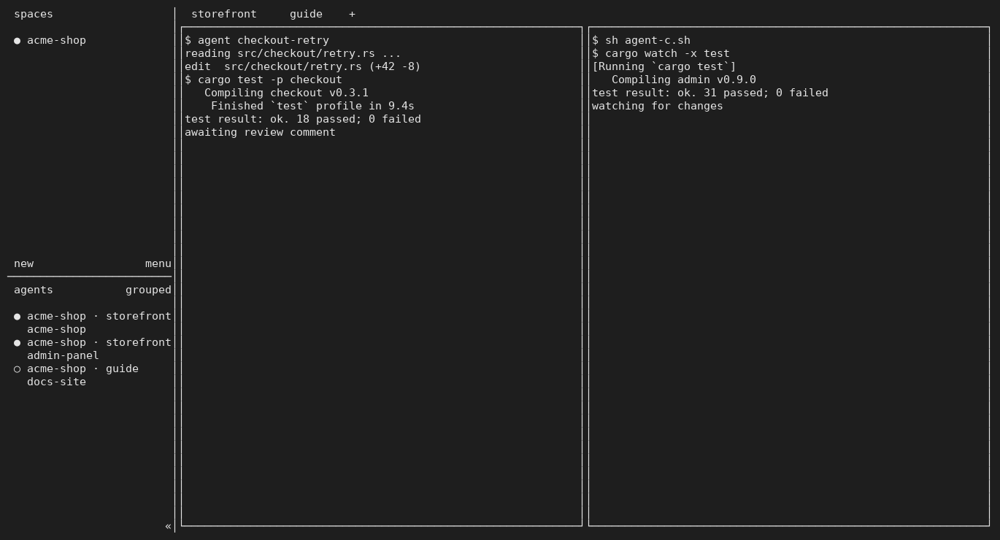

# hc-tui

An unofficial terminal UI for [herdr-core](https://github.com/herdrdev/herdr-core) (`hc`). It is for
people who work in a terminal or on a headless machine and want the Herdr TUI experience on top of `hc`:

- a sidebar of spaces and agents with live status, including machines added with `hc machine add`;
- tabs, split panes, zoom and keyboard lock;
- mouse selection that copies on release (through OSC 52, so your terminal has to allow it);
- Herdr's key bindings and configuration, read from your existing Herdr config;
- spaces and tabs read from the same `herdr-app` document the desktop app uses;
- local use, or remote use over plain SSH, with the session staying on the server.



## Install

hc-tui is one static binary. It needs the `hc` core itself installed —
see [herdr-core](https://github.com/herdrdev/herdr-core). Prebuilt archives cover Linux
(x86_64 and aarch64, static musl) and macOS (arm64 and Intel).

```sh
curl -fsSL https://github.com/followcat/hc-tui/releases/latest/download/install.sh | sh
```

The script verifies the archive against the release's `sha256sums.txt` and installs to
`~/.local/bin` without sudo. Pin a release with `HC_TUI_VERSION=v…`, or fetch an archive from the
[Releases page](https://github.com/followcat/hc-tui/releases) and check it yourself. Upgrade by
running the script again; uninstall by deleting the binary. Details: [docs/install.md](docs/install.md).
The first tagged release is pending — if the Releases page is still empty, build from source below.

## Status

Early, and the first tagged release is pending:

- **It runs on official `hc`.** CI builds a pinned official herdr-core from source and drives the real
  UI against it: sidebar, attach, switching, tabs, splits, status and detach. Day-to-day use is still mostly
  on [followcat/herdr-core](https://github.com/followcat/herdr-core), a fork of `hc`, so reports from
  official `hc` are especially welcome.
- **On official `hc`**, agents appear with a status only if they report it themselves (OSC 7501), and the
  sidebar's Git and hostname details are unavailable, because those facts exist only in the fork. See
  [Core compatibility](docs/compatibility.md) for the full per-core picture.
- **Not implemented yet:** keyboard copy mode and clipboard image paste. Text a program copies itself
  through OSC 52 doesn't reach your clipboard yet.

hc-tui stays a plain terminal client for `hc`. Multi-agent coordination is being built as a separate
project.

## Build from source

Requires a stable Rust toolchain (edition 2024) and Zig **0.16.0** on `PATH` (or via `ZIG=`): the `hc-vt`
crate builds `libghostty-vt` from the pinned `vendor/ghostty` submodule.

```sh
git clone --recursive https://github.com/followcat/hc-tui
cd hc-tui
cargo build --release -p hc-tui
./target/release/hc-tui --help
```

Run it against a local core, or a remote one over SSH:

```sh
hc-tui --session <name>
hc-tui --remote <ssh-target> --session <name>
```

The default prefix is Ctrl+B: `q` detaches, `w` opens workspace navigation, `b` toggles the sidebar and
`?` opens searchable help.

## More

- [Install, upgrade, uninstall](docs/install.md) · [Keys](docs/keys.md) ·
  [Remote use over SSH](docs/remote.md) · [Troubleshooting](docs/troubleshooting.md)
- [Runtime behaviour](docs/runtime.md)
- [Requirements](docs/requirements.md), [plan](docs/plan.md) and [progress](docs/progress.md)
- [Parity with Herdr](docs/parity.md) and the [owned-session parity harness](scripts/parity/README.md)

To run the tests: `git submodule update --init --depth 1`, then `cargo test`. The pinned revisions live in
`.gitmodules` and `NOTICE`.

Unofficial project, not affiliated with or endorsed by the Herdr project. Licensed under the
[Apache License 2.0](LICENSE).
