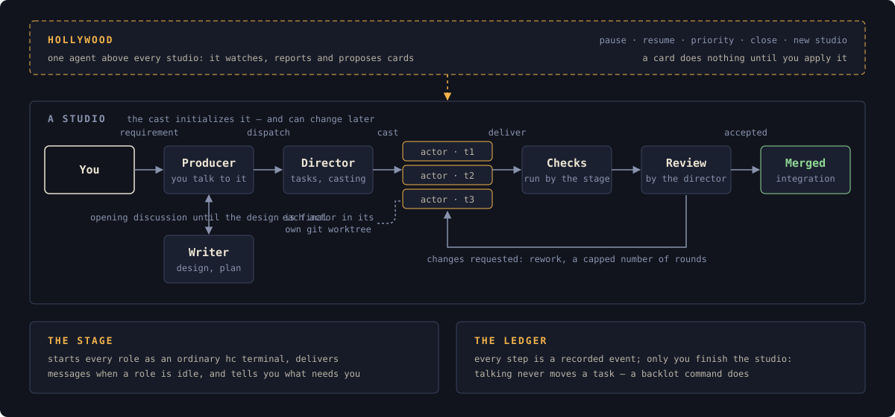

# backlot

A film studio for coding agents, in your terminal. You give one requirement to a producer; a director splits
it into tasks and casts agents onto them, each in its own git worktree; deliveries, checks, reviews and rework
go on a record; and a panel shows who is doing what. Every role is an ordinary terminal you can open and type
into.


*A demo studio on the test runner, with invented projects and agent output.*

backlot runs on [herdr-core](https://github.com/herdrdev/herdr-core) (`hc`), which keeps the terminals alive
on your machine or a server. The client is a complete terminal multiplexer, a fork of
[hc-tui](https://github.com/followcat/hc-tui); the studio layer on top of it is backlot's own. Unofficial
project, not affiliated with or endorsed by the Herdr project.

## What it is for

Running several coding agents by hand makes you the scheduler: you copy the plan between windows, remember who
is waiting for what, notice late that one of them stopped on a prompt, and lose track of which branch holds
what. backlot takes that job:

- **One requirement, a small cast.** You talk to the producer. A writer drafts the plan and the acceptance
  list with it, a director turns the plan into tasks and reviews the work, actors do the tasks.
- **Mixed casts.** Each role names its own agent CLI and model: Claude Code, Codex, Devin, OpenCode,
  cursor-agent or Command Code. A cheap model can do the typing while a stronger one reviews.
- **Nothing hidden.** Roles are plain `hc` terminals. Open one, read it, type into it. Stop backlot and they
  are still there.
- **A record, not a chat log.** Talking never moves a task; a `backlot` command does. The ledger says what was
  delivered, which checks ran, what the review said and who did it.
- **Your prompts stay yours.** The stage never answers a permission prompt that belongs to you. It tells you,
  and you decide.



## What works today

- **The whole studio loop**: requirement, plan and acceptance list, dispatch, tasks with dependencies, casting,
  delivery, checks, review, rework up to a cap, merge into an integration branch, finish.
- **The stage**, one scheduler per core. It starts each role in its place (actors in their own worktree and
  branch), delivers messages only when a role is idle and never into a dialog, nudges a step that is owed,
  runs your declared checks on every delivery in a clean worktree, and brings the roles back after `hc`
  restarts.
- **Attention.** A permission prompt, a stalled role, a step nobody took, a task at its rework cap: each is
  raised once, routed to the director when it may answer and to you when it may not.
- **The studio panel and cast**: the sidebar lists the current studio's people; `Ctrl+B y` opens a
  column of bordered blocks, one per studio — people, state, what is owed, what needs you.
  `Alt+arrows` move between studios and roles; Enter opens a person's terminal; `+` and `-`
  change a task's priority.
- **Several studios on one core**, each with its own repository, cast, ledger and limits.
- **Limits and budgets**: a cap of live roles per agent CLI, a running-time budget per task.
- **Hollywood, the overseer** (on `main`, not in a release yet): one agent above all studios. The stage tells it
  what happens in each studio; it reports, and it proposes *cards* (pause, resume, abandon, priority, close,
  reopen, new studio). A card does nothing until you apply it, and the stage checks again that nothing moved
  before it carries one out. Today you work with it from the command line; its floating layer in the client is
  the next step.
- **The terminal client**: sidebar of spaces and agents with live status, tabs, split panes, zoom, keyboard
  copy mode, mouse selection that copies on release, remote use over SSH with image paste, and a theme of its
  own.

What has been tried on real agents and what has only run on the test runner is written down, per agent CLI,
in [docs/studio/limits.md](docs/studio/limits.md). Read it before you trust a studio with real work.

## Install

backlot is one static binary. The script installs it and, when it's missing, the `hc` core it talks to.
Prebuilt archives cover Linux (x86_64 and aarch64, static musl) and macOS (arm64 and Intel).

```sh
curl -fsSL https://github.com/followcat/backlot/releases/latest/download/install.sh | sh
```

The script verifies the archive against the release's `sha256sums.txt` and installs to `~/.local/bin` without
sudo. Pin a release with `BACKLOT_VERSION=v…`, skip the core install with `BACKLOT_SKIP_CORE=1`, or fetch an
archive from the [Releases page](https://github.com/followcat/backlot/releases) and check it yourself. Upgrade
by running the script again; uninstall by deleting the binary. Details: [docs/install.md](docs/install.md).

**Releases lag `main`.** The latest one, v0.1.0, is the first studio release: it has the loop on Claude Code,
Codex, Devin and OpenCode. The cursor-agent and Command Code runners, stage-run checks, limits and budgets,
several studios on one core, Hollywood and the `backlot` theme came after it. Until the next release,
[build from source](#build-from-source) to get what this page describes.

## Run a studio

You need `hc`, a git repository with at least one commit, and at least one agent CLI installed and logged in.

**1. Say who plays each role**, in a cast file:

```toml
# /home/user/cast.toml
[producer]
runner = "claude"
model = "claude-sonnet-5-5"
effort = "high"
permission_profile = "standard"

[director]
runner = "claude"
model = "claude-sonnet-5-5"
effort = "high"
permission_profile = "standard"

[writer]
runner = "claude"
model = "claude-haiku-5-5"
effort = "medium"
permission_profile = "standard"

[[candidates]]            # the actors the director may cast
name = "actor-a"
runner = "codex"
model = "gpt-5.3-codex"
effort = "medium"
permission_profile = "worktree"

[[checks]]                # the stage runs these on every delivery
name = "units"
run = "cargo test --lib"
timeout_s = 120
```

**2. Create the studio and start the stage:**

```sh
hc server start
backlot studio new --studio acme-shop --title "Shop" --repo /home/user/acme-shop --cast /home/user/cast.toml
backlot stage start
```

**3. Open the client and talk to the producer:**

```sh
backlot
```

The sidebar shows the current studio's cast. `Ctrl+B y` opens the studio panel — one bordered block
per studio — and Enter on a studio focuses its producer: type what you want built, as you would
tell a person. From there the cast works; `Alt+Up`/`Alt+Down` switch studios, `Alt+Left`/`Alt+Right`
switch roles, and you watch the panel and answer what needs you.

The commands you will use most:

| Command | What it does |
|---|---|
| `backlot status --studio acme-shop` | The studio's recorded state and the steps still owed, with their owners. |
| `backlot tell director --file note.md --studio acme-shop --as user` | A recorded message to a role. |
| `backlot approve --person actor-t1-c1 --decision allow --studio acme-shop --as user` | Answer a permission prompt that is yours. |
| `backlot records --studio acme-shop` | What each actor delivered and how the reviews went. |
| `backlot tell hollywood "what is waiting on me?"` | Ask the overseer. It answers with a report. |
| `backlot card list`, `backlot card apply c1`, `backlot card cancel c1` | Hollywood's proposals: look, then apply or cancel. |
| `backlot studio finish --reason "all tasks accepted" --studio acme-shop --as user` | Close the studio. |

The full walkthrough, with the cast file's every key, permission prompts, recovery after a restart and where
the files live, is [docs/studio/guide.md](docs/studio/guide.md). Hollywood is set up in
[docs/studio/hollywood.md](docs/studio/hollywood.md).

## The client

backlot is also the terminal you work in. The default prefix is `Ctrl+B`:

| Keys | |
|---|---|
| `Ctrl+B y` | The studio panel |
| `Ctrl+B w` | Move between spaces, tabs and agents |
| `Ctrl+B v`, `Ctrl+B -` | Split the pane to the right, or downwards |
| `Ctrl+B b` | Show or hide the sidebar |
| `Ctrl+B s` | Settings: theme, status indicators, sound, notifications |
| `Ctrl+B ?` | Every key, searchable |
| `Ctrl+B q` | Detach. Everything keeps running |
| `Ctrl+G` | Lock the keyboard, so every key goes to the program |

Key bindings, the sidebar and the other settings are read from your Herdr config when you have one. Run it
against a local core or a remote one over plain SSH:

```sh
backlot --session <name>
backlot --remote <ssh-target> --session <name>
```

More in [docs/keys.md](docs/keys.md) and [docs/remote.md](docs/remote.md).

### Theme

backlot has a look of its own, so you can tell it from hc-tui and Herdr at a glance: marquee gold on midnight
blue. Pick another theme with `Ctrl+B s`, or set `source = "herdr"` to follow your Herdr theme.
[docs/theme.md](docs/theme.md) has the details.


## Status

Early, and honest about it:

- **Two casts have run the whole loop on real agents.** Claude Code in every role, four times on a sample
  repository; the fourth run stopped the `hc` core twice and every live role resumed its own session. And a
  mixed cast, twice: Devin as director, cursor-agent as writer and Command Code as the actors, with the
  producer on the test runner; the second run had two actors at once and ended with the studio finished.
  Codex and OpenCode were launched and measured, not run through a whole studio.
  [docs/studio/limits.md](docs/studio/limits.md) has the details.
- **Hollywood has only run on the test runner.** Its floating layer in the client and its first run on a real
  agent are the next two steps.
- **It runs on official `hc`**, which CI builds from source and drives the real UI against. Day-to-day use is
  still mostly on [followcat/herdr-core](https://github.com/followcat/herdr-core), a fork of `hc`. On official
  `hc` an agent shows a status only if it reports one itself, and the sidebar's Git and hostname details are
  unavailable. See [Core compatibility](docs/compatibility.md).
- **The macOS builds** pass CI but haven't been tried on a real Mac yet.

## Build from source

You need stable Rust (edition 2024) and Zig **0.16.0** on `PATH`, or set `ZIG=`. Zig builds `libghostty-vt`
from the pinned `vendor/ghostty` submodule.

```sh
git clone --recursive https://github.com/followcat/backlot
cd backlot
cargo build --release -p hc-tui
./target/release/backlot --help
```

To run the tests: `git submodule update --init --depth 1`, then `cargo test`.

## Docs

- [Run a studio](docs/studio/guide.md)
- [Hollywood, the overseer](docs/studio/hollywood.md)
- [The studio panel](docs/studio/panel.md)
- [Studio: what has and has not been tried](docs/studio/limits.md)
- [Install, upgrade, uninstall](docs/install.md)
- [Keys](docs/keys.md)
- [Theme](docs/theme.md)
- [Remote use over SSH](docs/remote.md)
- [Troubleshooting](docs/troubleshooting.md)
- [Core compatibility](docs/compatibility.md)
- [Runtime behaviour](docs/runtime.md)

For development: [requirements](docs/requirements.md), [plan](docs/plan.md), [progress](docs/progress.md),
[the studio's design](docs/studio/design.md), [parity with Herdr](docs/parity.md) and the
[parity harness](scripts/parity/README.md).

## License

[Apache License 2.0](LICENSE). Not affiliated with or endorsed by the Herdr project.
