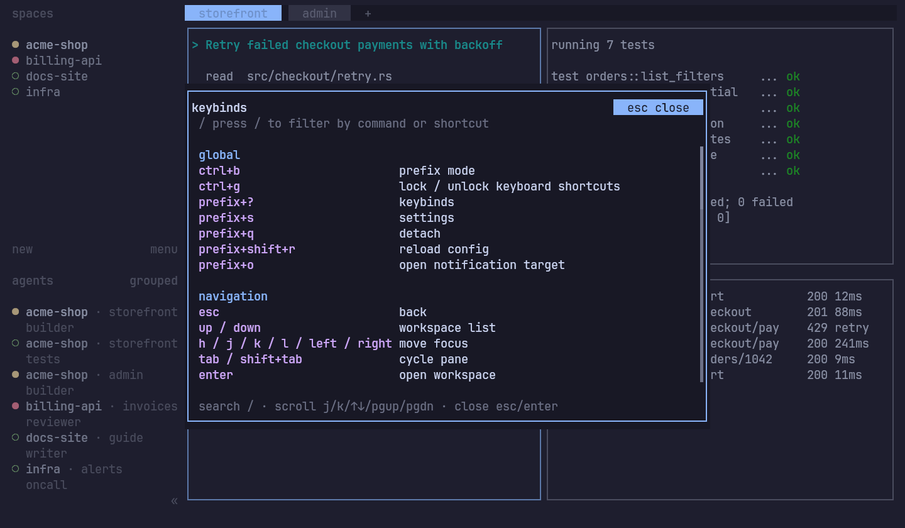

# Keys

hc-tui uses Herdr's key model: press a prefix, then an action key. The default prefix is `Ctrl+B`. If you have a Herdr
config (`~/.config/herdr/config.toml`), hc-tui uses its prefix and bindings.

Press `Ctrl+B ?` for the full list, which you can search. It always matches your config.

The defaults you'll use most:

| Keys | Action |
|---|---|
| `Ctrl+B q` | Detach (`hc` keeps running) |
| `Ctrl+B w` | Navigate workspaces |
| `Ctrl+B b` | Show or hide the sidebar |
| `Ctrl+B ?` | Search the key bindings |
| `Ctrl+B s` | Settings |
| `Ctrl+B c` | New tab |
| `Ctrl+B v`, `Ctrl+B -` | Split right, split down |
| `Ctrl+B h/j/k/l` | Move focus |
| `Ctrl+B z` | Zoom the pane |
| `Ctrl+B r` | Resize mode |
| `Ctrl+B x` | Close the pane |
| `Ctrl+G` | Lock the keyboard, so every key goes to the program. Press again to unlock. |

`Ctrl+B Ctrl+B` sends a literal `Ctrl+B` to the program. Custom commands bound in your Herdr config work here too.

Settings changed with `Ctrl+B s` (theme, status indicators, sound, toast delivery) are saved to your Herdr config.
Nothing else in that file changes. [Runtime](runtime.md) covers the prefix, lock and navigation in more detail.
