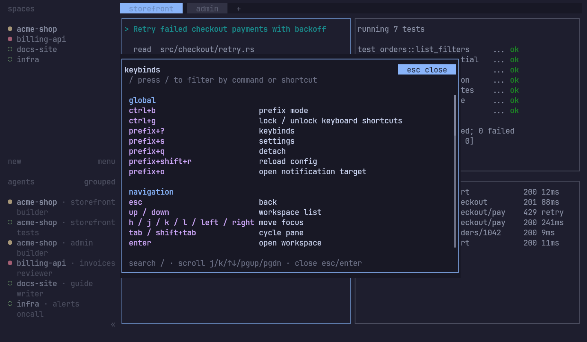
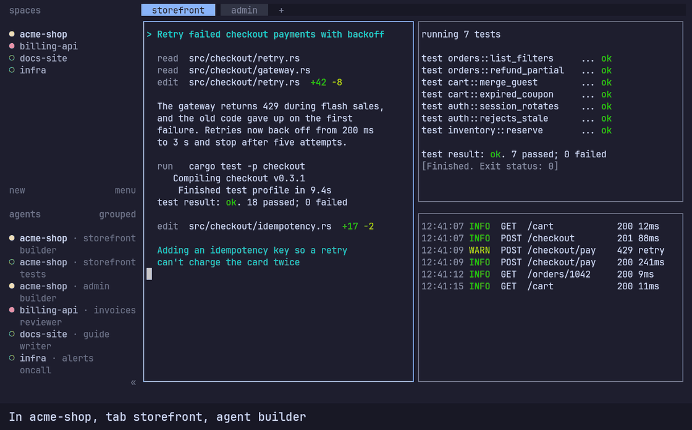
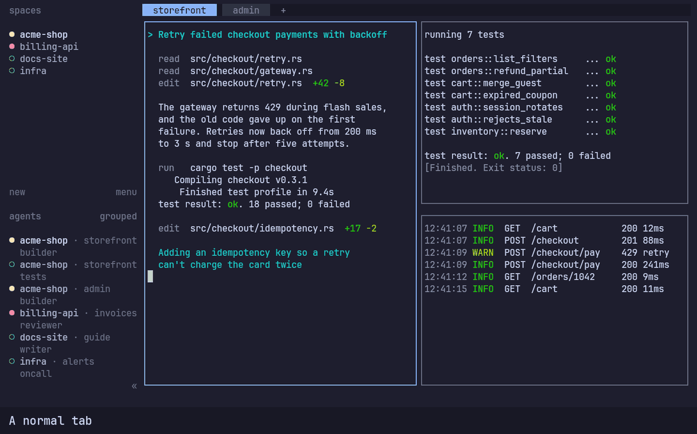

# Keys

backlot uses Herdr's key model: press a prefix, then an action key. The default prefix is `Ctrl+B`. If you have a Herdr
config (`~/.config/herdr/config.toml`), backlot uses its prefix and bindings.

Press `Ctrl+B ?` for the full list, which you can search. It always matches your config.



The defaults you'll use most:

| Keys | Action |
|---|---|
| `Ctrl+B q` | Detach (`hc` keeps running) |
| `Ctrl+B w` | Navigate workspaces |
| `Ctrl+B b` | Show or hide the sidebar |
| `Ctrl+B ?` | Search the key bindings |
| `Ctrl+B s` | Settings |
| `Ctrl+B c` | New tab — a studio shell in the focused person's worktree |
| `Ctrl+B m` | Studio menu for the focused pane — a role pane's role menu, a shell pane's studio menu |
| `Ctrl+B v`, `Ctrl+B -` | Split right, split down — a studio shell joining the focused tab |
| `Ctrl+B h/j/k/l` | Move focus |
| `Ctrl+B z` | Zoom the pane |
| `Ctrl+B r` | Resize mode |
| `Ctrl+B x` | Close the pane |
| `Ctrl+B y` | Toggle the studio panel |
| `Ctrl+G` | Lock the keyboard, so every key goes to the program. Press again to unlock. |

`Ctrl+B Ctrl+B` sends a literal `Ctrl+B` to the program. Custom commands bound in your Herdr config work here too.

Settings changed with `Ctrl+B s` (status indicators, sound, toast delivery) are saved to your Herdr config, and
nothing else in that file changes. A theme picked there is saved to backlot's own config ([Theme](theme.md)). In
studio mode the overlay gains a `studio` tab — call-sheet start policy, the direct `Alt+Y` toggle, the dock width
and the read-only Hollywood overseer (Enter opens `backlot hollywood setup` while it is unset) — which writes to
backlot's own `config.toml`. [Runtime](runtime.md) covers the prefix, lock and navigation in more detail.

## The studio panel

`Ctrl+B y` — the prefix, then `y` — opens the studio panel. Pressing the chord again while it is
focused closes it; while it is open but unfocused the chord focuses it. A Herdr binding on `y`
still wins whenever the panel does not own the keys. The chord's tail is `panel.key` in
`~/.config/backlot/config.toml`.

The panel — the studio dock — has three modes: closed (the default — zero width, no keys), a
16-column collapsed strip, and an expanded column (38 columns at 160+, 36 at 100+, 28 under) of
bordered studio blocks. It sits beside the panes while they keep at least 44 columns; below that
it overlays the pane surface. The selection is a `▌` cursor that lands only on actionable rows —
titles and spacers are skipped. While it is focused it owns these keys:

| Keys | Action |
|---|---|
| `j`/`k`, arrows | Move the selection |
| `PageUp`/`PageDown` | Scroll |
| `Enter` | Focus a live person's terminal / make a studio current (a closed person shows `closed — press o to reopen`) |
| `Space` | Open or close the drawer under a person or task; fold a studio block |
| `o` | Reopen a closed resumable person |
| `v` | Open the Task & Delivery Sheet |
| `p` | Peek the terminal |
| `y`/`d` | Answer a user-owned prompt |
| `+`/`-` | Raise or lower a task's priority |
| `r`/`f` | Start the stage / finish the studio |
| `m` | The row's context menu — same list a right-click opens |
| `c` | Switch collapsed and expanded |
| `q` | Close the dock |
| `?` | Open this help |
| `Esc` | Beside the panes: unfocus the dock. As an overlay: back to the strip, or close |

Right-click on a dock row selects it and opens the same menu `m` opens on the selection.
While an action runs its row spins a dim `⠋ <verb>…` marker on the right edge — a second
press of the same command waits for the first to finish.

[docs/studio/guide.md](studio/guide.md) explains what the panel's marks and blocks mean.

## The opening page

With no studio (no `backlot` document yet, or a good one with zero studios) an opening page
covers the pane area and owns these keys. The client waits for its first `backlot` read before
drawing the page — at most two seconds — so a client that already has studios never flashes it:

| Keys | Action |
|---|---|
| `n` | New studio — the native four-step dialog (machine & repo, id & title, cast, check & start) |
| `h` | Tell Hollywood — the input line, only when `[hollywood]` is configured |
| `s` | Start the stage, only when it is not running |
| `q` | Detach |
| `Esc` | Hide the page for this session; `new_workspace` brings it back |

`new_workspace` shows the page instead of an empty workspace — in studio mode every new terminal
belongs to a studio, so the empty-workspace flow does not apply. With at least one studio it
never covers the studios: it opens the new-studio dialog directly instead.

## The Hollywood bar

`Alt+Y` — a direct key, no prefix — toggles the film-strip band dropped from the top. Collapsed,
the bar is the **lot pill** in the chrome row: a reserved, clickable segment at the right end of
the tab bar — or of the one-row studio header on a studio workspace — that counts the urgent
items (`U`: your prompts, stopped stages, ledger errors), the open cards and studios ready to
finish (`C`), and the studios (`✦`). In studio mode the bar exists even with no `[hollywood]`
table, in its no-agent form; `backlot --plain` has no bar at all, and `Alt+Y` there reaches the
program. `[keys] call_sheet` rebinds the direct key (empty string unbinds it), `[keys]
prefix_call_sheet` the prefix-chord tail (`Ctrl+B i` by default), and `[hollywood] key` fills
whichever slot `[keys]` leaves unset. `[hollywood] start` picks the start policy: `collapsed`
(the default — the bar no longer opens by itself), `when_waiting` (expanded only while U > 0),
or `expanded`. While the band is expanded it owns these keys:

| Keys | Action |
|---|---|
| `←`/`→`, `h`/`l` | Move between the studio frames, the new-studio frame included |
| `↓`/`↑`, `j`/`k` | Move between the waiting rows, and back to the frames |
| `1`–`9`, `0` | Jump to a studio frame, `0` to the new-studio frame |
| `Enter` | Activate the selection — a frame opens it, a prompt opens the role, a card shows it, an offline machine reports its last read |
| `y` / `d` | On a prompt row: `backlot approve … allow` / `deny` on the prompt's machine |
| `p` | On a prompt row: peek at the role's live screen, read-only |
| `r` | On a stage row: `backlot stage start` on that machine |
| `a` / `x` / `s` | On a card row: `backlot card apply` / `cancel` / `show` |
| `f` | On a ready row: arm `finish studio?`, then `y` runs `backlot studio finish`, `n`/`Esc` stands down |
| `n` | New studio — the dialog, with the bar collapsed first |
| `i` | Edit the `tell hollywood` line, with an agent |
| `m` | The selected row's context menu |
| `?` | The key list, in `Ctrl+B ?` |
| `PageUp`/`PageDown` | Scroll the waiting list |
| `Esc` | Collapse it to the pill |

A click on a row or a chip selects it — activation stays on the keys; a right-click opens the
row's context menu; a click on the input line opens it for editing, and the wheel scrolls the
frames sideways or the waiting rows under the pointer. The `+ new studio` frame is the
exception: it is a button, and a click opens the new-studio dialog directly.

## Studio menus and dialogs

`m` on a dock row, `m` on a Call Sheet row, right-click on either (or on a cast row or the
studio header), and `Ctrl+B m` from a focused pane all open the same context menu for that
target: focus/peek/sheet navigation, prompt answers, task verbs, tells and the lifecycle
commands. `↑`/`↓` and `Enter` walk it, each item's shown letter activates it, and `Esc` or a
click outside closes it. An item that would be a no-op is dimmed with its reason (`current`,
`no terminal`, `unreachable`) or hidden entirely.

The menu's `…` items open the native dialogs — a reason field (pause, resume, abandon,
takeover; card cancel and finish take an optional one), a confirm card (close a role, stop the
stage, clear stale attention, answer a director-routed prompt), the four-row Tell editor, and
the Revise editor prefilled from `requirements/v<n>.md` (`Ctrl+E` rewrites it in `$EDITOR` on a
local studio). Every dialog cancels on `Esc` or a click outside and submits with `Enter`/`y`.

Every `backlot` command the TUI runs answers the same way: the row spins `⠋ <verb>…` while it
runs, a success toast shows for 3.5 seconds, and a failure card holds for 8 seconds with the
command's first `stderr` line — a remote studio's toast always names its machine (`host-b:
paused task t1` / `host-b failed: …`). `C` on the failure card, or a click on `copy cmd`,
writes the exact command line (`ssh <machine> -- backlot …` for a remote studio) to the
clipboard; `Esc` or a click dismisses it.

## The New Studio dialog

Every studio-mode new-studio entry — `Ctrl+B N` over a studio, `n` on the opening page or in the
Call Sheet, the `+ new studio` frame, the sidebar's `new · <machine>` (which preselects that
machine) — opens the same four-step overlay: **1 Machine & Repo**, **2 ID & Title**, **3 Cast**,
**4 Check & Start**. `Esc` steps back (4→3→2→1, then closes with the values kept), `Ctrl+C`
cancels from any step, and a click outside closes it. Step 1's `Ctrl+R` re-checks the machines'
reachability and `backlot --version`.

| Step | Keys |
|---|---|
| 1 Machine & Repo | `Tab` between the machine list and the repository list; `↑`/`↓` move; `→`/`←` descend/ascend a directory; `/` filters; `Enter` picks the repository. A machine without `backlot`, or offline, shows its reason and cannot be picked; a git repository without commits is disabled with its hint; a repository another studio uses warns. |
| 2 ID & Title | `Tab`/`↑`/`↓` between fields; the id validates live against `[a-z0-9][a-z0-9_-]*` and that machine's existing studios; `Enter` continues. |
| 3 Cast | `↑`/`↓` pick the role, `←`/`→` cycle the runner/model/effort among what `backlot runners --json` found on the target machine; `a` adds an actor candidate, `x` removes one; `e` on a model cell types a free-text model; `Ctrl+E` edits the generated cast.toml in `$EDITOR` and reloads it; `Ctrl+R` re-probes. |
| 4 Check & Start | `Space` toggles `[x] Ensure stage is running`; `Enter` runs `backlot studio new` on the target machine — over hc's `terminal.run` when it is remote — then `stage start` when checked, and the new producer's terminal takes focus. |

The dialog creates a studio on any attached machine: every question is answered by running
`backlot … --json` on that machine, so a remote repository path is never checked against the
local disk. A remote studio's cast travels on stdin (`studio new --cast -`) — no file is left
behind. In a terminal, `backlot studio new --interactive` still asks the same questions.

## Studio keys

backlot is always in studio mode (start it with `--plain` for the plain multiplexer), so four
direct keys — no prefix — move between studios and roles. They are bound in
`~/.config/backlot/config.toml` and default to the `Alt+arrow` chords:

```toml
[keys]
previous_studio = "alt+up"
next_studio = "alt+down"
previous_role = "alt+left"
next_role = "alt+right"
```

| Keys | Action |
|---|---|
| `Alt+Up`, `Alt+Down` | Previous or next studio in document order. Wraps around. Focuses the person last used there, else the studio's producer, else its first live role. A studio with no live terminal still becomes current — the cast and the panel frame follow — and a notice says so. |
| `Alt+Left`, `Alt+Right` | Inside a studio workspace: previous or next person of the current studio in cast order, then its shells. Wraps around and skips people with no live terminal. Pressed from outside the studio's cast, the first press focuses the remembered person. |

Focusing goes through the panel's existing focus path (workspace, tab, pane): it only moves the
focus — no pane and no program is resized.

These keys exist only in studio mode — that is, always unless you run `backlot --plain`. They
win over a Herdr binding on the same key — the usual Herdr config binds `previous_tab = "alt+left"`
and friends — so set different chords in either file if you want both; `Ctrl+B ?` lists each
studio key with the Herdr action it shadows on your config. `Alt+Left`/`Alt+Right` own the key
only inside a studio workspace — on your own workspaces and on the `backlot` stage workspace the
keys fall through to Herdr's `previous_tab`/`next_tab`. Under `--plain` Herdr's
bindings, or the program, get the keys exactly as before. An empty string unbinds a key; a value
that does not parse falls back to the default with one notice naming the file.

They also work while the studio panel or a persistent float has the focus — the float parks on
its tab and keeps running, as it does for the tab and agent keys below. While the keyboard is
locked (`Ctrl+G`) the program gets them instead, and in copy mode they do what Herdr's
`previous_tab` does there.

## Scrolling a pane

`PageUp` and `PageDown` page the focused pane's scrollback by one pane height when the program does
not use them itself: a shell or a line editor on the normal screen, like a prompt that takes pasted
text. A program on the alternate screen, one reporting the mouse, or a pager in application cursor
mode gets the keys instead, so `less`, `vim` and similar apps keep their own paging. Modified page
keys such as `Ctrl+PageUp` always reach the program, and any key the program does get jumps the view
back to the bottom. The mouse wheel scrolls the pane the same way.

Inside a floating terminal (`type = "popup"`), every key goes to the popup's program, so `PageUp` and
`PageDown` do not page the pane behind it.

## Copy mode

`Ctrl+B [` enters copy mode on the focused pane. The program gets none of these keys; the copy cursor
walks the visible screen and the scrollback above it, and `y` copies the selection through OSC 52.

| Keys | Action |
|---|---|
| `h` `j` `k` `l` or arrows | Move the copy cursor |
| `w` `b` `e` | Next word start, previous word start, word end |
| `W` `B` `E` | Same, on whitespace-delimited big words |
| `{` `}` | Previous or next paragraph (blank line) |
| `0` `Home` | Line start |
| `^` `$` `End` | First non-blank cell, line end |
| `g` `G` | Top of history, bottom of the screen |
| `Ctrl+U` `Ctrl+D` | Half page up, half page down |
| `PageUp` `PageDown` | Full page up, full page down |
| `/`, `?` | Search forward or backward; `Enter` runs it, `Esc` cancels |
| `n` `N` | Repeat the search forward or backward |
| `v` or `Space` | Start a selection; `V` selects whole lines |
| `y` or `Enter` | Copy the selection and leave copy mode |
| `Esc` | Clear the selection or search; press again to leave |
| `q` | Leave copy mode |

Rebind the entry key with `keys.copy_mode` in your Herdr config, for example `copy_mode = "prefix+escape"`.

The prefix still arms inside copy mode (unless a search prompt is open): press it, then a normal
binding key, or `Esc` to cancel the armed prefix. Because the prefix key is claimed first, the
copy-mode `Ctrl+B`/`Ctrl+F` page keys only fire when you have bound a different prefix.

Entering copy mode drops any mouse selection in progress.

Inside a popup terminal there is no copy mode: drag with the mouse to select over the popup's visible
frame and the selection copies on release, through the same OSC 52 path as pane selection.

## Alt shortcuts

None of these are bound by default. Add the ones you want to `~/.config/herdr/config.toml`, then press `Ctrl+B Shift+R`
to reload it.

### Update

`prefix+u` opens the update card when a newer backlot is known, or the release notes of the running version right after
an upgrade. Rebind it with `keys.update` in your Herdr config, for example `update = "prefix+x"`; a binding you set wins
over the default.

### Switch tabs and agents

```toml
[keys]
previous_tab = "alt+left"
next_tab = "alt+right"
previous_agent = "alt+up"
next_agent = "alt+down"
```

| Keys | Action |
|---|---|
| `Alt+Left`, `Alt+Right` | Previous or next tab in the current workspace. Wraps around. |
| `Alt+Up`, `Alt+Down` | Previous or next entry in the sidebar's agents list. Wraps around. |



`Alt+Up` and `Alt+Down` follow the agents list, so one press can land in another pane, tab, workspace or machine.
Machines that are offline are skipped. Plain shells aren't in the list: a program counts as an agent only while it has
a status.

### Floating terminal

A `[[keys.command]]` entry binds a key to a command. With `type = "popup"`, the command runs in a floating terminal over
the current tab. This one opens your shell on `Alt+F`:

```toml
[[keys.command]]
key = "alt+f"
type = "popup"
command = "exec \"${SHELL:-sh}\""
description = "open floating terminal"
width = "80%"
height = "80%"
```



`width` and `height` take a percentage or a number of cells. While the popup is open, every key goes to it, including
`Esc`.

A popup that just runs an interactive shell — like the `Alt+F` example above — is a *persistent float* per tab: press the
key again to hide it, press it once more to bring it back. Leaving the tab hides it too, but the program keeps running
and coming back shows it again if it was open when you left. It starts in the project directory of the tab it belongs
to, and it ends only when its program exits or when you close that tab or workspace. Other popup commands stay
one-shot: they close and end when you leave the tab. Set `persistent = true` on a `[[keys.command]]` entry to give any
popup command the same per-tab behavior, or `persistent = false` to keep even a shell one-shot. While a float is
starting, its own chord is held back until the terminal is up.

While a persistent float is focused, the keys bound to `previous_tab`/`next_tab`/`previous_agent`/`next_agent` — the
`Alt+arrow` shortcuts above, if you set them — still switch tabs and agents: the float parks on its tab and keeps
running, exactly as if you had clicked away. Any `[[keys.command]]` popup chord also still works, so `Alt+F` toggles
the float instead of typing into it. The program loses exactly those chords — press, repeat and release; everything
else, `Esc` included, reaches it, and an action with no binding loses nothing.

The persistent float draws a dressed frame: the panes behind it dim, a one-cell drop shadow sits right and below, and
the corners are rounded. Its title carries the binding, the owning tab and the program, with the hide chord hinted on
the right — the hint drops when the frame is too narrow to show it clear of the title. The border is the theme accent
while the float is focused and turns muted while the keyboard is locked (`Ctrl+G`).

```text
╭ float alt+f — work — zsh          alt+f hide · esc sends to program ╮
│                                                                   │
│  ~/project                                                        │
│  $                                                                │
│                                                                   │
╰───────────────────────────────────────────────────────────────────╯
 ░░░░░░░░░░░░░░░░░░░░░░░░░░░░░░░░░░░░░░░░░░░░░░░░░░░░░░░░░░░░░░░░░░░░░░░
```

One-shot popups keep the plain square frame.

## Pasting text and images

`Ctrl+Shift+V` pastes text. That is your terminal's own shortcut, and the program receives it as a bracketed paste,
unchanged. While a popup is open the paste goes to the popup's program, wrapped only when that program asked for
bracketed paste, just like a pane.

On a remote endpoint `Ctrl+V` pastes a clipboard image instead. backlot reads your local clipboard, uploads the image
to the program's machine with `terminal.put`, and the program receives the path of the uploaded file. This applies to
`backlot --remote`, to backlot running inside an SSH session, and to a focused terminal on another machine
(`machine/tN`). On a plain local endpoint `Ctrl+V` goes to the program unchanged. Local programs read the clipboard
themselves, and Vim needs it for block-visual.

The trigger is `keys.remote_image_paste` in `~/.config/herdr/config.toml`, default `"ctrl+v"`. Set it to `""` to
disable the key. Two other gestures do the same thing wherever it applies: dropping an image file on the window, and
an empty bracketed paste. An empty paste is what a terminal sends for `Ctrl+Shift+V` when the clipboard holds only an
image. PNG, JPEG, GIF, WebP and BMP are recognized, up to the 8 MB `terminal.put` limit. On Linux the read needs
`wl-paste` under Wayland or `xclip` under X11.

A copied image file works too. A file manager puts `x-special/gnome-copied-files` or `text/uri-list` on the
clipboard, and some tools put one absolute image path in `text/plain`. backlot resolves the local file and uploads its
bytes, the same way as a drop.

A paste that cannot work never fails silently. When the clipboard holds no image and no readable image file, `Ctrl+V`
still reaches the program, and a notice says so. When nothing can read the clipboard at all (no display, no tool, or a
clipboard owner that stopped answering), the notice says why.
