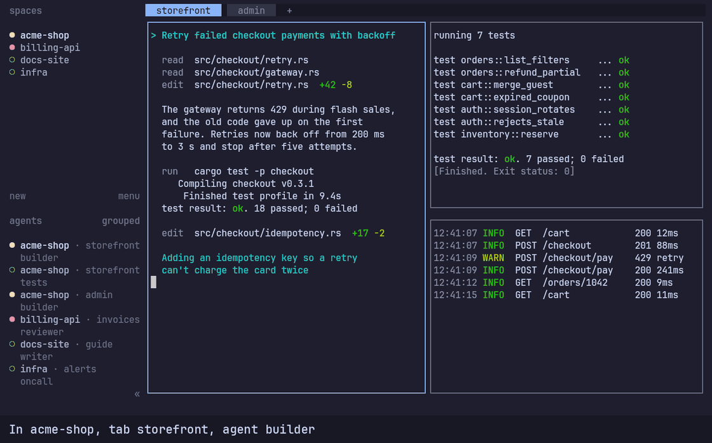
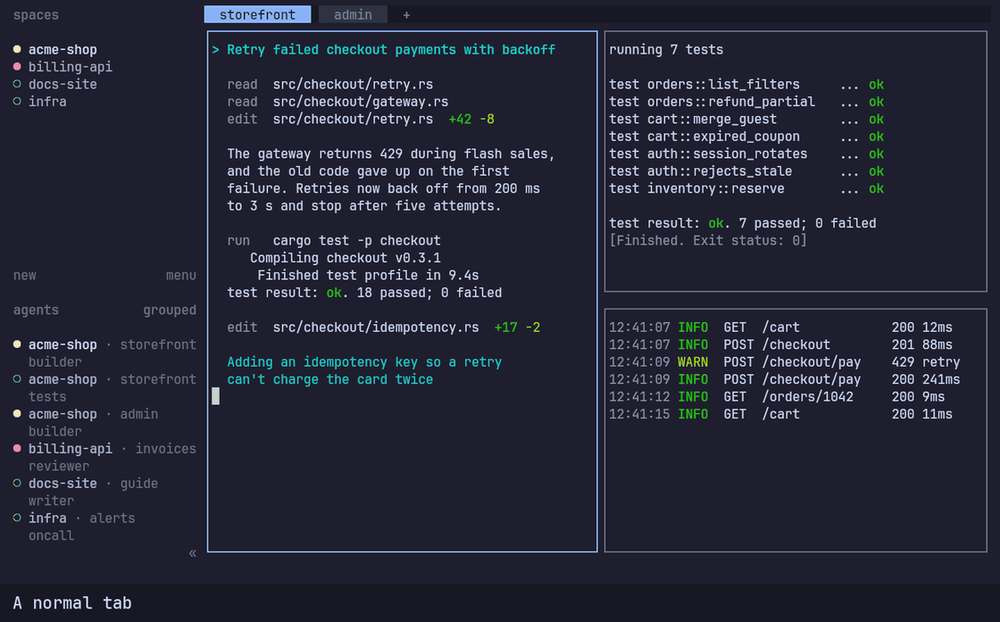

# Keys

hc-tui uses Herdr's key model: press a prefix, then an action key. The default prefix is `Ctrl+B`. If you have a Herdr
config (`~/.config/herdr/config.toml`), hc-tui uses its prefix and bindings.

Press `Ctrl+B ?` for the full list, which you can search. It always matches your config.


The defaults you'll use most:

| Keys | Action |
|---|---|
| `Ctrl+B q` | Detach (`hc` keeps running) |
| `Ctrl+B w` | Navigate workspaces |
| `Ctrl+B b` | Show or hide the sidebar |
| `Ctrl+B ?` | Search the key bindings |
| `Ctrl+B s` | Settings |
| `Ctrl+B c` | New tab |
| `Ctrl+B v`, `Ctrl+B -` | Split right, split down |
| `Ctrl+B h/j/k/l` | Move focus |
| `Ctrl+B z` | Zoom the pane |
| `Ctrl+B r` | Resize mode |
| `Ctrl+B x` | Close the pane |
| `Ctrl+G` | Lock the keyboard, so every key goes to the program. Press again to unlock. |

`Ctrl+B Ctrl+B` sends a literal `Ctrl+B` to the program. Custom commands bound in your Herdr config work here too.

Settings changed with `Ctrl+B s` (theme, status indicators, sound, toast delivery) are saved to your Herdr config.
Nothing else in that file changes. [Runtime](runtime.md) covers the prefix, lock and navigation in more detail.

## Alt shortcuts

None of these are bound by default. Add the ones you want to `~/.config/herdr/config.toml`, then press `Ctrl+B Shift+R`
to reload it.

### Switch tabs and agents

```toml
[keys]
previous_tab = "alt+left"
next_tab = "alt+right"
previous_agent = "alt+up"
next_agent = "alt+down"
```

| Keys | Action |
|---|---|
| `Alt+Left`, `Alt+Right` | Previous or next tab in the current workspace. Wraps around. |
| `Alt+Up`, `Alt+Down` | Previous or next entry in the sidebar's agents list. Wraps around. |



`Alt+Up` and `Alt+Down` follow the agents list, so one press can land in another pane, tab, workspace or machine.
Machines that are offline are skipped. Plain shells aren't in the list: a program counts as an agent only while it has
a status.

### Floating terminal

A `[[keys.command]]` entry binds a key to a command. With `type = "popup"`, the command runs in a floating terminal over
the current tab. This one opens your shell on `Alt+F`:

```toml
[[keys.command]]
key = "alt+f"
type = "popup"
command = "exec \"${SHELL:-sh}\""
description = "open floating terminal"
width = "80%"
height = "80%"
```



`width` and `height` take a percentage or a number of cells. While the popup is open, every key goes to it, including
`Esc`. It closes when its program exits, so type `exit` or press `Ctrl+D`. Leaving its tab also closes it and ends its
program.
